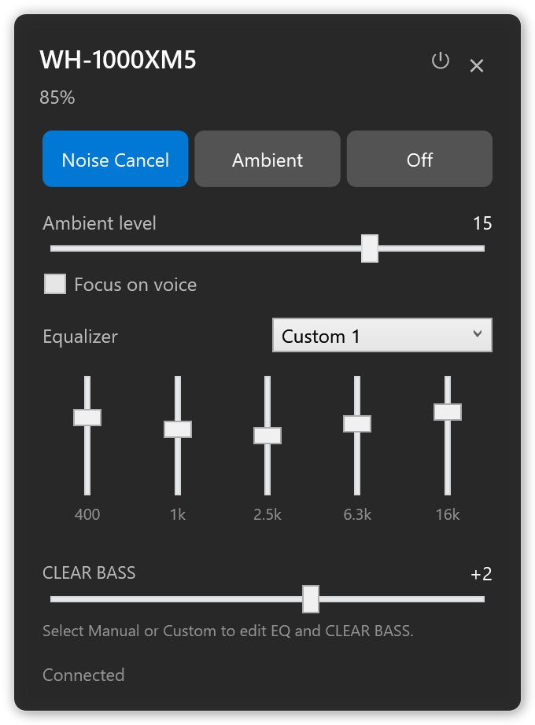

<div align="center">


# Sony Tray

**Noise cancelling, EQ and battery for Sony headphones, from the Windows tray or the macOS menu bar.**

[](https://github.com/abhiinhii/sony-tray/releases/latest)
[](https://github.com/abhiinhii/sony-tray/actions/workflows/ci.yml)
[](#windows)
[](#macos)
[](LICENSE)

&nbsp;&nbsp;

</div>

## Features

- **Noise control:** Noise Cancelling, Ambient (level 1–20, Focus on Voice) and Off
- **Equalizer:** 12 presets, with five bands plus CLEAR BASS or ten bands, depending on the model
- **Battery:** headset, left/right and case levels
- **Power off**, two-way sync with the headset's buttons, and automatic reconnect
- **No installer:** one exe on Windows, one app on macOS

## Install

### Windows

[**Download SonyTray.exe**](https://github.com/abhiinhii/sony-tray/releases/latest/download/SonyTray.exe) and run it. Pair the headphones in Windows Settings first.

SmartScreen may warn because the exe is unsigned. Choose **More info › Run anyway**.

### macOS

[**Download SonyTray-macos-universal.zip**](https://github.com/abhiinhii/sony-tray/releases/latest/download/SonyTray-macos-universal.zip) (macOS 13+, Apple Silicon and Intel). Unzip it and move **SonyTray.app** to Applications.

The app isn't notarized, so clear the quarantine flag once before opening it:

```bash
xattr -dr com.apple.quarantine /Applications/SonyTray.app
```

Allow Bluetooth access when asked. The headphones must be **connected** to the Mac, not just paired. See [macos/README.md](macos/README.md) for more.

## Use

Click the tray or menu-bar icon to open the controls. **×** or **Esc** hides them; the headphones stay connected. Right-click the icon to start with the system or quit.

## Supported devices

| Device | Status |
| --- | --- |
| WH-1000XM5 | ✅ Tested |
| Other Sony v2-protocol models (WH-1000XM6, WF-1000XM5, LinkBuds, ULT Wear, WH-CH720N, …) | 🟡 Should work; reports welcome |
| WH-1000XM4, WH-1000XM3 and other v1-protocol models | 🔜 Planned |

Sony Tray asks the headset what it supports and shows only those controls.

## Build from source

**Windows** (.NET 8 SDK):

```bash
dotnet test
dotnet publish src/SonyTray -c Release -r win-x64 --self-contained -p:PublishSingleFile=true -p:IncludeNativeLibrariesForSelfExtract=true -o publish
```

**macOS** (Xcode or the Command Line Tools 16+):

```bash
cd macos
make install   # build and copy to /Applications
make test      # optional: run the tests
```

## Troubleshooting

- **Windows:** `SonyTray.exe --probe` checks the connection. Logs: `%AppData%\SonyTray\logs\app.log`
- **macOS:** see [macos/README.md](macos/README.md#troubleshooting). Logs: `~/Library/Logs/SonyTray/app.log`

## Credits

Protocol ported from [SonyHeadphonesClient](https://github.com/mos9527/SonyHeadphonesClient) (MIT), originally by [Plutoberth](https://github.com/Plutoberth/SonyHeadphonesClient). Tray icon via [Hardcodet.NotifyIcon.Wpf](https://github.com/hardcodet/wpf-notifyicon) (Code Project Open License). Sony Tray is [MIT licensed](LICENSE).

Sony Tray is not affiliated with, endorsed by, or sponsored by Sony. "Sony" and related product names are trademarks of Sony Group Corporation, used here only to describe compatibility.
