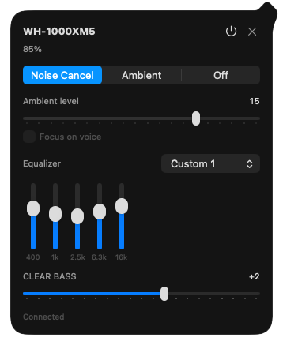

# Sony Tray for macOS

The menu-bar version of Sony Tray. It needs macOS 13 or later and runs natively on Apple Silicon and Intel.



## Install

**Download** [SonyTray-macos-universal.zip](https://github.com/abhiinhii/sony-tray/releases/latest/download/SonyTray-macos-universal.zip), or from a terminal:

```bash
curl -L -o ~/Downloads/SonyTray.zip https://github.com/abhiinhii/sony-tray/releases/latest/download/SonyTray-macos-universal.zip
ditto -x -k ~/Downloads/SonyTray.zip /Applications
xattr -dr com.apple.quarantine /Applications/SonyTray.app
open /Applications/SonyTray.app
```

The app is signed but not notarized, so macOS blocks it until the `xattr` line removes the quarantine flag. If you'd rather click, use **System Settings › Privacy & Security › Open Anyway**.

**Build from source** with the Command Line Tools or Xcode 16+ (macOS 14.5+). No `xattr` step needed:

```bash
xcode-select --install   # if the Command Line Tools aren't installed yet
git clone https://github.com/abhiinhii/sony-tray.git
cd sony-tray/macos
make install             # or: make install PREFIX=~/Applications
```

## First launch

- **Allow Bluetooth access** when asked. To change it later, use System Settings › Privacy & Security › Bluetooth.
- **Connect the headphones to this Mac.** Being paired isn't enough: they must show as connected in System Settings › Bluetooth.
- **Install the app before turning on Launch at Login.** The login item points to wherever the app is when you turn it on.

## Use

Sony Tray lives in the menu bar, with no Dock icon. Click its icon for the controls. **×**, **Esc** or another click on the icon hides them, and the headphones stay connected. On short screens the controls scroll below the header.

Right-click the icon for **Launch at Login**, **Reveal Logs in Finder** and **Quit**.

- **To update,** download the latest zip again, or run `git pull && make install`.
- **To remove,** delete the app (or run `make uninstall`), then delete `~/Library/Logs/SonyTray`.

## Troubleshooting

**"Connect the headphones to this Mac"** means they're paired but not connected. Connect them in System Settings › Bluetooth. If they keep dropping, check for a multipoint link to a phone. Sony Tray waits for a real connection instead of forcing one, because forcing it makes the headset drop the link.

**Check the connection** with `make probe`. It connects, reads the headset, briefly changes the noise mode, restores your settings, and exits with 0 on success. To see its output in a terminal, give the terminal Bluetooth access first, or read the log.

For a longer check, quit the app, then run:

```bash
open -W build/SonyTray.app --args --probe --verify
```

This also changes one EQ band and restores it, waits for two refreshes, and reconnects three times. Results go to the log.

**Logs**, including every message sent to and received from the headset, are in `~/Library/Logs/SonyTray/app.log`.

## Development

```bash
make test             # protocol and session/UI tests (mock Bluetooth; needs a logged-in desktop)
make app              # universal build/SonyTray.app (UNIVERSAL=0 for this Mac only, CONFIG=debug)
make run              # build, then launch from build/
make dist             # release zip; checks it is universal, macOS 13+, system libraries only
make snapshot         # render the panel to build/flyout.png (layout only)
make regenerate-icon  # rebuild AppIcon.icns from docs/icon.png
```

- Launch the **bundle** (`make run` or `open build/SonyTray.app`), not the binary inside it. macOS stops a bare binary that uses Bluetooth.
- Each build gets a new ad-hoc signature, so macOS asks for Bluetooth access again.
- The tests use a mock transport, so they don't prove a particular headset works.

### Toolchain

- **Swift 6 is required:** the Command Line Tools or Xcode 16+. The built app still runs on macOS 13, and `make` checks the compiler version before building.
- `make` calls `swiftc` directly. `Package.swift` is there for Xcode and SwiftPM, but `swift build` can fail with the Command Line Tools alone, because their `libPackageDescription` doesn't match its module.
- Some installs leave a stale `usr/include/swift/module.modulemap` that breaks every Foundation import. [`scripts/swift-compat-flags.sh`](scripts/swift-compat-flags.sh) works around it on every build. To fix it for good, run `sudo rm /Library/Developer/CommandLineTools/usr/include/swift/module.modulemap` or reinstall the Command Line Tools.

### Code layout

| Path | Contents |
| --- | --- |
| `Sources/SonyProtocolKit` | Swift port of `src/SonyProtocol`: framing, commands, parsing |
| `Sources/SonyTrayMac` | Bluetooth transport (IOBluetooth), session and menu-bar UI |
| `Sources/SonyProtocolTests`, `Tests/SessionTests` | Protocol tests and session/UI tests |

Each Windows class in `src/SonyTray` has a macOS counterpart with the same role. For example, `RfcommClient` becomes `RFCOMMClient`, `FlyoutWindow` becomes `FlyoutView` in an `NSPopover`, and `StartupManager` becomes `LaunchAtLogin`. IOBluetooth calls back on the thread that opened the channel, so the transport, session and UI all run on the main actor.
